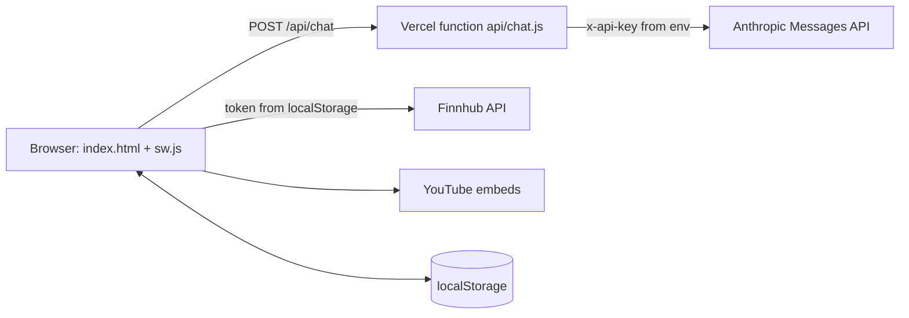

# FinAI Architecture

## Pieces
- **`index.html`** — the whole UI and logic in one file. Global state object `S`; helpers `ai(prompt, sys, maxT)` for one-shot calls and `sendChat()` for the chat.
- **`api/chat.js`** — serverless proxy. Reads `ANTHROPIC_API_KEY` from the environment, forwards `model`, `max_tokens`, `system`, `messages` to `https://api.anthropic.com/v1/messages`, and passes errors back as `{error, status, type}`. Avoids CORS and keeps the key off the client.
- **`sw.js`** — cache name `finai-v5`; network-first for same-origin GETs with an offline fallback; skips Anthropic, Google Fonts and YouTube; handles push, notification clicks and scheduled notifications sent via `postMessage({type:'SCHED'})`.
- **`manifest.json`** — standalone PWA, icons 72–512px.
- **`vercel.json`** — builds `api/chat.js` with `@vercel/node` and `index.html` as static; routes `/api/chat` to the function and everything else to `index.html`.

## AI call pattern
1. Feature builds a prompt from local data (portfolio, budget, ticker).
2. `ai()` POSTs to `/api/chat` with a feature-specific system prompt.
3. The reply's text blocks are joined and rendered; errors go to the on-screen debug log.

Related: [Deployment](Deployment.md) · [Data & Storage](Data-and-Storage.md) · [Claude API Patterns](../02-AI-Automation/Claude-API-Patterns.md)
