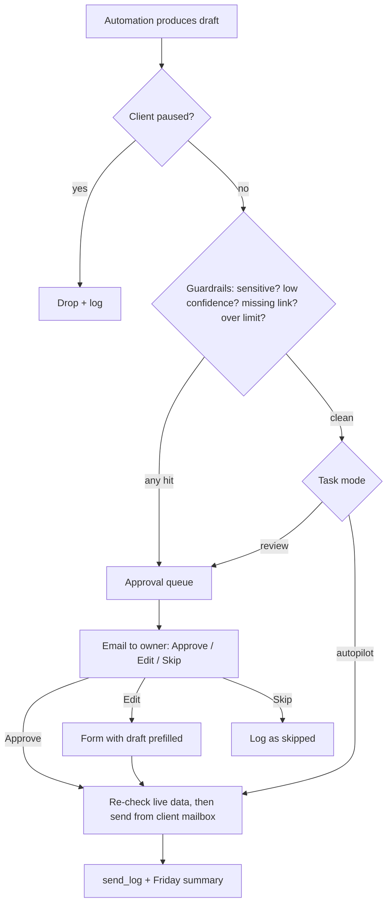

# Review Mode & Autopilot: One Shared Engine

Every automation hands its outgoing message to one sub-workflow, the **Outbox**. **Only the Outbox can send.** That gives one place for review mode, autopilot, guardrails, logging, rate limits and the kill switch.

## Tables
- `task_config`: client_id, task (invoices/leads/inbox/scheduling), `mode` (review/autopilot), `paused`, voice guide, FAQ, rules JSON (do-not-chase list, minimum amount), owner approval email, time zone, business hours.
- `approvals`: id, client_id, task, to, subject, body, context, `token` (32 random characters), status (pending/approved/edited/skipped/expired), created_at, decided_at, edited_body.
- `send_log`: everything sent, with who approved it or "autopilot". This is the audit trail.

## The approval email
1. Insert the draft into `approvals` with a fresh random token.
2. Email the owner who it's to, why, the draft, and three buttons: `https://n8n.yourdomain.com/webhook/approve?t=TOKEN&a=approve|edit|skip`.
3. **The GET link must not act directly.** Outlook Safe Links and other scanners "click" every link, which would auto-approve. The webhook returns a page with a **Confirm** button, and only its POST sends.
4. **Edit** opens an n8n Form prefilled with the draft. The edited version is sent and logged, and edits show how to tune the prompt.
5. Tokens are single-use and expire after 72 h, with one reminder at 24 h. **Never send on timeout.**
6. Before any send, **re-check live data**: is the invoice still unpaid, the slot still free, has the customer replied since?

> [!TIP]
> **For the first demo**, n8n's Gmail/Email "Send and Wait for Response" (Approve/Disapprove buttons) is fine. Move to the `approvals` table before real clients: it handles edits and scanner clicks, survives restarts, and feeds the Friday summary.

## Guardrails: always go to review, even on autopilot
- Classified as refund, complaint, cancellation, legal, angry, health or money dispute.
- Confidence below 0.8, or a stop reason other than a normal finish.
- The draft mentions a number, date or promise that's not in the input. A Code node checks that every `$` amount appears in the source.
- An invoice reminder without a payment link; a recipient who isn't a known contact.
- More than N sends per hour per client (start at 20), or a second automated message to the same person within 24 h.

## When to switch a task to autopilot
**30+ drafts reviewed** for that task, **90%+ approved without edits** over the last 2 weeks, and the owner says yes in writing (an email reply is enough). Store `autopilot_since`. Autopilot sends still appear in the Friday summary, and the owner can reply "pause" to any summary, which sets `paused = true`.

## Friday summary (every client, every week)
At 4pm on Fridays, query `send_log`, `approvals`, `chase_log` and `leads`: what was sent, approved and skipped, money chased and money paid since the first reminder, new leads and how many booked, and items waiting on the owner. Claude writes it up as a 150-word email. **These numbers are what make clients renew.**

## Voice guide (once per client)
With permission, export 20–30 recent sent emails (personal details removed), run the [voice prompt](Prompt-Library.md), let the owner correct the one-page result, and save it in `task_config`. Every drafting prompt includes it.

Related: [Stack & Costs](Stack-and-Costs.md) · [Prompt Library](Prompt-Library.md) · [Testing Before Go-Live](Testing.md)
